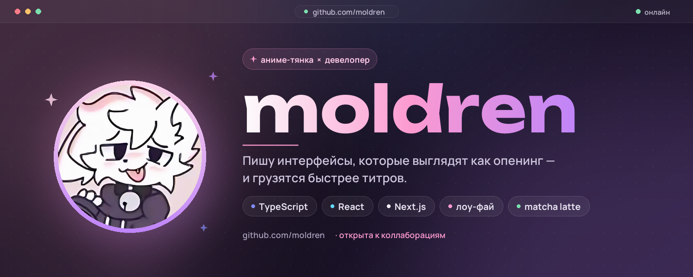

<!--
  GitHub Profile README — moldren
  Репозиторий должен называться так же, как ник: moldren (public).
  Картинку положи в assets/waifu.jpg — инструкция в SETUP.md
  Шапка профиля — assets/banner.png, собирается scripts/make-banner.py
-->

<div align="center">

<a href="https://github.com/moldren">
  
</a>

<br/>

<a href="https://github.com/moldren">
  
</a>

<br/>


</div>

<br/>

## 🌸 Обо мне

```ts
const moldren = {
  ник:      "moldren",
  вайб:     ["аниме", "лоу-фай", "чистый git log"],
  пишу:     ["React", "TypeScript", "Next.js"],
  верю:     "красивый интерфейс — это тоже фича",
  не_люблю: ["merge conflict в 3 ночи", "console.log в проде"],
  девиз:    "сначала запусти, потом уже стесняйся",
};
```

- 🎀 Верстаю интерфейсы, которые выглядят как опенинг, а грузятся быстрее титров
- 🍥 Люблю аниме, мятный латте и аккуратные компоненты
- 🐈‍⬛ Сейчас прокачиваю фронтенд и собираю уютные пет-проекты
- ⚡ Факт: первый коммит был `hello world`, второй — `fix hello world`
- 💌 Открыта к коллаборациям, ревью и совместным вайб-кодинг сессиям

## 🍥 Стек

<div align="center">


</div>

## 📊 Статистика

<div align="center">


<br/>


</div>

## 🏆 Сводка профиля

<div align="center">


</div>

<!-- Трофеи — включи, если сервис оживёт (у него бывают периоды 402):
<div align="center">

</div>
-->

## 🐍 Змейка ест мои коммиты

<div align="center">

<picture>
  <source media="(prefers-color-scheme: dark)" srcset="https://raw.githubusercontent.com/moldren/moldren/output/github-contribution-grid-snake-dark.svg" />
  <source media="(prefers-color-scheme: light)" srcset="https://raw.githubusercontent.com/moldren/moldren/output/github-contribution-grid-snake.svg" />
  
</picture>

</div>

## 🌙 Что я делаю сейчас

- 🌸 Собираю пет-проект с аниме-эстетикой и нормальным DX
- 📖 Разбираюсь в архитектуре фронтенда глубже, чем в сюжете Evangelion
- 🎧 Слушаю лоу-фай и рефакторю то, что «работало и так»

<!-- Раскомментируй и подставь свои репозитории:

## 📌 Пины

| 🌸 Репозиторий | Что это | Стек |
|:---|:---|:---|
| [waifu-ui](https://github.com/moldren/waifu-ui) | UI-кит в пастельных тонах | React · TS · Tailwind |
| [neko-notes](https://github.com/moldren/neko-notes) | Заметки с котиками | Next.js · Prisma |
| [lofi-player](https://github.com/moldren/lofi-player) | Плеер для учёбы | Vite · Web Audio |

-->

## 💭 На сегодня

<div align="center">

> «Если сомневаешься — деплой в пятницу.»
>
> — какой-то очень смелый сеньор 🌸

</div>

## 📫 Связаться

<div align="center">

<a href="https://github.com/moldren"></a>
<!-- Замени ссылки на свои:
<a href="https://t.me/USERNAME"></a>
<a href="mailto:you@example.com"></a>
-->

</div>

<div align="center">


</div>
<!-- profile readme -->
